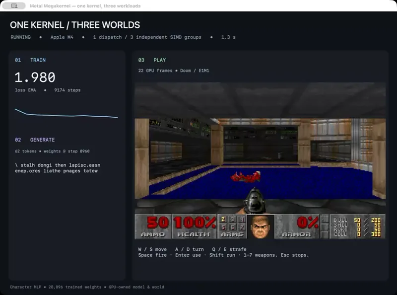

# Metal Megakernel

## What’s going on?

Play Doom while your Mac trains a tiny language model and uses it to write text.
In the recording, Doom is on the right. The loss graph on the left shows how
well the model predicts the next character, and the text below it comes from
the model as it learns.

[](docs/media/demo.mp4?raw=true)

*12 seconds on an Apple M4, with scripted Doom input and no audio.*
[Download the MP4](docs/media/demo.mp4?raw=true)

## How does it work?

The Mac starts one GPU program, called a kernel, and leaves it running. Inside
that single launch, 96 GPU threads split into three teams of 32:

1. **Train.** Read a sample of text, guess the next character from the previous
   eight, then update the model based on the error.
2. **Generate.** Take a complete copy of the latest weights and use it to
   produce more characters while training continues.
3. **Play.** Read the controls, advance Doom, and draw the next frame.

The CPU loads the game data, sends keyboard input and timing, and shows the
results in an AppKit window. The GPU does the learning, text generation, and
Doom gameplay and rendering. [Integration details](docs/doom-integration.md)

## What’s different from the CUDA demo?

This project borrows its three-job setup from Jerry Zhu and Arnold Xu’s open CUDA demo.
The table compares this version with their small character demo. Their
repository also includes a separate, later GPT version with about 162 million
parameters. [Open Flapping Airplanes source](https://github.com/Bobliuuu/open-flapping-airplanes) · [Source notes](docs/original-research.md)

| | Open CUDA demo | Metal Megakernel |
| --- | --- | --- |
| Hardware | NVIDIA GPU with CUDA | Apple Silicon GPU with Metal |
| Model | 512 units in the hidden layer and 115,296 learned weights | 128 units and 28,896 learned weights, about a quarter as many |
| How work is assigned | GPU workers pick up tasks, prioritizing Doom, then generation, then training | Each job has its own fixed team of 32 threads |
| How generation reads the model | Reads the shared weights that training updates | Reads complete snapshots of the weights |
| How Doom gets onto the GPU | Compiles Doom to NVIDIA GPU code | Builds Doom C into native Metal functions using a WebAssembly intermediate, via the pinned Metal Doom submodule |

Both small models predict one character at a time from the previous eight. The
Metal window is written in Objective-C++ with AppKit, and its GPU code uses
Metal Shading Language. [Metal Doom](https://github.com/vamsi-aribandi/metal-doom)

## Try it on your Mac

You’ll need an Apple Silicon Mac, Python 3.9 or newer, and a compatible Doom
game data file (IWAD), such as `doom1.wad`. Bring your own IWAD.

Install Apple’s Command Line Tools with `xcode-select --install` if needed.
Then run these commands with Homebrew installed:

```sh
brew install llvm lld wabt
git clone --recurse-submodules https://github.com/vamsi-aribandi/metal-megakernel.git
cd metal-megakernel
./run.sh --wad /path/to/doom1.wad
```

Run `./run.sh` without arguments to pick the IWAD in a window. The first build
and GPU compilation can take a little while.

| Keys | Action |
| --- | --- |
| W / S or ↑ / ↓ | Move forward or backward |
| A / D or ← / → | Turn |
| Q / E | Strafe |
| Space / Enter | Fire / use |
| Shift / 1–7 | Run / select a weapon |
| Tab / M / Z | Map / game menu / confirm in menu |
| Esc or close the window | Stop all three jobs |

## Tests and details

```sh
DOOM_WAD=/path/to/doom1.wad ./test.sh
```

The tests compare training updates against a Python reference and replay Doom
frames against a native C reference. In a one-minute run, the app completed
**525,642 training steps**, generated **3,585 characters**, and rendered **2,055
Doom frames**. Every captured frame matched the reference.
[Run evidence](docs/evidence/doom-60s/README.md)

Live CPU/GPU communication uses an undocumented Metal compiler feature, so
compatibility can change with macOS or compiler updates.
[Integration and validation details](docs/doom-integration.md) ·
[CPU/GPU communication notes](docs/host-gpu-coherence.md)

The combined program is GPL-2.0-or-later. [Credits and licenses](CREDITS.md)
