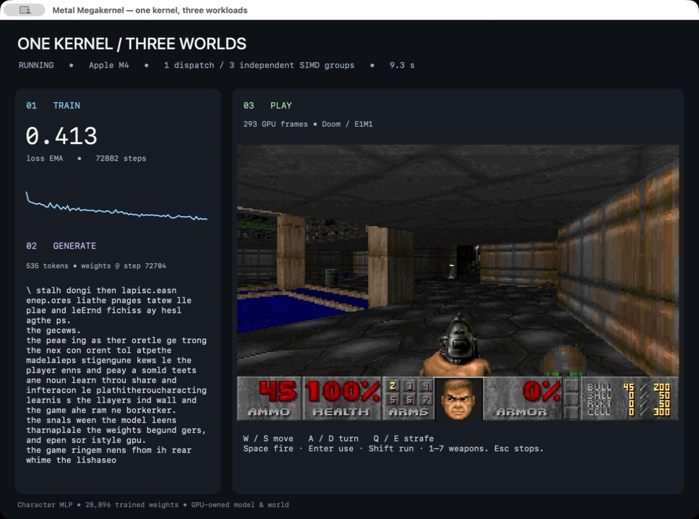

# Metal Megakernel

Play Doom while your Mac trains a tiny language model and generates text from
it. All three jobs run together inside one Metal GPU dispatch.

[](docs/media/demo.mp4?raw=true)

[Watch the 12-second demo (MP4)](docs/media/demo.mp4?raw=true). The clip shows the
macOS app running on an Apple M4 with scripted Doom input. It’s silent.

## Try it on your Mac

You’ll need an Apple Silicon Mac, Python 3.9 or newer, and a compatible Doom
game data file (IWAD), such as `doom1.wad`. Bring your own IWAD.

Install Apple’s Command Line Tools with `xcode-select --install` if needed.
Then run these commands with Homebrew installed:

```sh
brew install llvm lld wabt
git clone --recurse-submodules https://github.com/vamsi-aribandi/metal-megakernel.git
cd metal-megakernel
./run.sh --wad /path/to/doom1.wad
```

Run `./run.sh` without arguments to pick the IWAD in a window. The first build
and GPU compilation can take a little while.

| Keys | Action |
| --- | --- |
| W / S or ↑ / ↓ | Move forward or backward |
| A / D or ← / → | Turn |
| Q / E | Strafe |
| Space / Enter | Fire / use |
| Shift / 1–7 | Run / select a weapon |
| Tab / M / Z | Map / game menu / confirm in menu |
| Esc or close the window | Stop all three jobs |

## What’s running on the GPU?

The app launches 96 GPU threads once and splits them into three groups of 32.
Each group keeps doing its job until you stop the app.

- **Train** learns to predict the next character from the previous eight.
- **Generate** samples characters using fresh copies of the weights as training
  updates them. You can see patterns from the sample text start to appear.
- **Play** advances the actual Doom game and draws each frame. The CPU sends
  keyboard input and timing, then displays the finished frames.

The GPU code uses Metal Shading Language. The Mac window uses Objective-C++
and AppKit. The Doom submodule compiles the original C engine to native Metal
functions through a WebAssembly build step. [Metal Doom](https://github.com/vamsi-aribandi/metal-doom)

## What changed from upstream?

The original project used CUDA. This version runs on Apple Silicon and uses
128 hidden units instead of 512 in upstream’s small character model. That’s
**28,896 learned weights**, about a quarter of upstream’s 115,296. The earlier
Metal demo used a maze while the Doom port was in development.
[open-flapping-airplanes by Jerry Zhu and Arnold Xu](https://github.com/Bobliuuu/open-flapping-airplanes)

## Tests and details

```sh
DOOM_WAD=/path/to/doom1.wad ./test.sh
```

The tests compare training updates against a Python reference and replay Doom
frames against a native C reference. In a one-minute run, the app completed
**525,642 training steps**, generated **3,585 characters**, and rendered **2,055
Doom frames**. Every captured frame matched the reference.
[Run evidence](docs/evidence/doom-60s/README.md)

Live CPU/GPU communication uses an undocumented Metal compiler feature, so
compatibility can change with macOS or compiler updates.
[Integration and validation details](docs/doom-integration.md) ·
[CPU/GPU communication notes](docs/host-gpu-coherence.md)

The combined program is GPL-2.0-or-later. [Credits and licenses](CREDITS.md)
